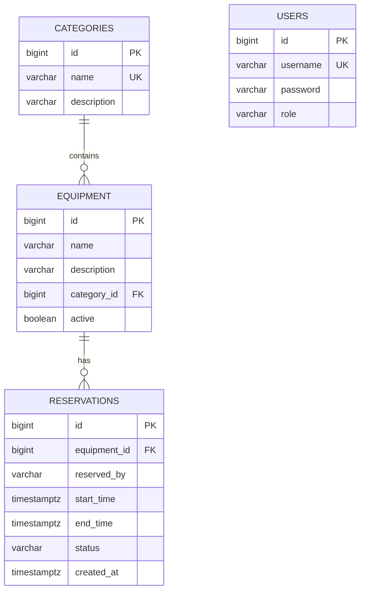

# FitRent

FitRent to backend aplikacji do rezerwowania sprzętu sportowego. Umożliwia zarządzanie kategoriami i sprzętem oraz rezerwowanie dostępnego sprzętu na określony czas. Logika biznesowa sprawdza aktywność sprzętu, poprawność terminu i kolizje z potwierdzonymi rezerwacjami.

Repozytorium: [Matthias3721/FitRent](https://github.com/Matthias3721/FitRent).

## Technologie

| Obszar | Technologia |
| --- | --- |
| Język | Java 21 |
| Backend | Spring Boot 4.1.2, Spring Web MVC |
| Dostęp do danych | Spring Data JPA / Hibernate |
| Baza danych | PostgreSQL 16 jako osobna usługa |
| Migracje | Flyway |
| Bezpieczeństwo | Spring Security, JWT, BCrypt |
| Walidacja | Jakarta Bean Validation |
| Dokumentacja API | springdoc-openapi 3.2.0 / Swagger UI |
| Testy | JUnit 5, Mockito, Spring Boot Test, MockMvc |
| Budowanie | Maven Wrapper |
| Uruchomienie bazy | Docker Compose |

## Główne funkcjonalności

- Rejestracja użytkowników i logowanie zwracające JWT.
- Role `USER` i `ADMIN` oraz ograniczenia dostępu do endpointów.
- Pełny CRUD kategorii i sprzętu.
- Listowanie, odczyt, tworzenie, anulowanie i usuwanie rezerwacji.
- Stronicowanie sprzętu, wyszukiwanie po nazwie i filtrowanie po aktywności.
- Walidacja requestów, obsługa błędów i migracje schematu bazy.

Projekt udostępnia backend REST API. API można obsługiwać w Postmanie lub innym kliencie HTTP. Katalog `frontend/` nie zawiera zaimplementowanego interfejsu użytkownika.

## Uruchomienie — Windows / PowerShell

### 1. Wymagania

- JDK 21 z poprawnie ustawionym `JAVA_HOME` i poleceniem `java` w `PATH`.
- Docker Desktop z uruchomionym silnikiem i Docker Compose.
- Git.
- Dostęp do internetu podczas pierwszego pobierania Mavena, zależności i obrazu PostgreSQL.
- Wolne porty `5432` (baza) i `8080` (backend).

Maven Wrapper znajduje się w repozytorium — osobna instalacja Mavena nie jest wymagana.

### 2. Pobranie projektu

```powershell
git clone https://github.com/Matthias3721/FitRent.git
cd FitRent
```

Przy pracy na istniejącej kopii należy wejść do jej katalogu głównego, zawierającego `docker-compose.yml`.

### 3. Konfiguracja

Przy pierwszym uruchomieniu skopiuj szablon i uzupełnij lokalne wartości:

```powershell
Copy-Item .env.example .env
notepad .env
```

Jeśli `.env` już istnieje, edytuj go bez ponownego kopiowania szablonu.

| Zmienna | Znaczenie |
| --- | --- |
| `POSTGRES_DB` | Nazwa bazy, np. `fitrent` |
| `POSTGRES_USER` | Użytkownik bazy, np. `fitrent` |
| `POSTGRES_PASSWORD` | Własne hasło użytkownika bazy |
| `JWT_SECRET` | Własny losowy sekret JWT, minimum 32 bajty dla HS256 |
| `ADMIN_USERNAME` | Login administratora tworzonego przy starcie; opcjonalny |
| `ADMIN_PASSWORD` | Własne hasło administratora; opcjonalne razem z loginem |

Wartości z `.env.example` są przykładami i wymagają zastąpienia. Sekret JWT można wygenerować w PowerShellu:

```powershell
$jwtBytes = New-Object byte[] 32
$rng = [System.Security.Cryptography.RandomNumberGenerator]::Create()
$rng.GetBytes($jwtBytes)
$rng.Dispose()
[Convert]::ToBase64String($jwtBytes)
```

Wynik wklej jako wartość `JWT_SECRET` w `.env`. W pliku zapisuj po jednej parze `NAZWA=wartość` na linię, bez otaczających cudzysłowów.

Plik `.env` i skrypty `*.local.ps1` są ignorowane przez Git. Nie umieszczaj w repozytorium rzeczywistych haseł ani tokenów.

### 4. Uruchomienie PostgreSQL i wczytanie konfiguracji backendu

Z katalogu głównego projektu:

```powershell
docker compose up -d
docker compose ps
```

Docker Compose wczytuje `.env` automatycznie. Backend uruchamiany przez Maven potrzebuje tych wartości w zmiennych środowiskowych bieżącego terminala. W tym samym katalogu wykonaj:

```powershell
Get-Content -LiteralPath .env | ForEach-Object {
    $line = $_.Trim()
    if ($line -and -not $line.StartsWith('#')) {
        $parts = $line -split '=', 2
        if ($parts.Count -eq 2) {
            [Environment]::SetEnvironmentVariable(
                $parts[0].Trim(), $parts[1], 'Process'
            )
        }
    }
}
```

Poczekaj, aż PostgreSQL będzie gotowy do połączeń. Logi można sprawdzić poleceniem `docker compose logs postgres`.

### 5. Uruchomienie backendu

W tym samym terminalu:

```powershell
cd backend
.\mvnw.cmd spring-boot:run
```

Backend działa pod `http://localhost:8080`. Flyway automatycznie wykonuje brakujące migracje przy uruchamianiu aplikacji. Hibernate nie tworzy schematu — ustawione jest `spring.jpa.hibernate.ddl-auto=none`.

Jeżeli `ADMIN_USERNAME` i `ADMIN_PASSWORD` są niepuste, aplikacja tworzy konto `ADMIN`, o ile podany login jeszcze nie istnieje. Zmiana tych zmiennych nie zmienia hasła ani roli istniejącego konta. Rejestracja przez API tworzy wyłącznie konta `USER`.

Backend zatrzymasz przez `Ctrl+C`. Następnie z katalogu głównego możesz zatrzymać bazę:

```powershell
cd ..
docker compose down
```

Dane PostgreSQL pozostają w wolumenie `fitrent-pgdata`. Zmiana hasła w `.env` nie zmienia hasła użytkownika w już zainicjalizowanej bazie. Nie usuwaj wolumenu, jeśli chcesz zachować dane.

## Struktura i architektura

| Ścieżka | Odpowiedzialność |
| --- | --- |
| `backend/src/main/java/pl/fitrent/category/` | Kategorie: kontroler, serwis, repozytorium, encja i DTO |
| `backend/src/main/java/pl/fitrent/equipment/` | Sprzęt, stronicowanie i filtrowanie |
| `backend/src/main/java/pl/fitrent/reservation/` | Rezerwacje i ich reguły biznesowe |
| `backend/src/main/java/pl/fitrent/user/` | Konta, rejestracja, logowanie i inicjalizacja administratora |
| `backend/src/main/java/pl/fitrent/security/` | Konfiguracja zabezpieczeń i obsługa JWT |
| `backend/src/main/java/pl/fitrent/common/exception/` | Wyjątki i globalna obsługa błędów |
| `backend/src/main/resources/db/migration/` | Migracje Flyway |
| `backend/src/test/` | Testy jednostkowe i integracyjne |
| `docker-compose.yml` | Usługa PostgreSQL i trwały wolumen danych |

Request przechodzi przez filtry Spring Security, następnie trafia do kontrolera. Kontroler przyjmuje i waliduje DTO requestu oraz wywołuje serwis. Serwis realizuje logikę biznesową i korzysta z repozytorium Spring Data JPA do komunikacji z PostgreSQL. Wynik jest mapowany na DTO odpowiedzi i zwracany jako JSON. Wyjątki aplikacyjne obsługuje `GlobalExceptionHandler` z `@RestControllerAdvice`.

## Model danych / ERD



Każdy sprzęt należy do jednej kategorii. Każda rezerwacja dotyczy jednego sprzętu. Kategoria i sprzęt mogą mieć wiele rekordów zależnych. Klucze obce blokują usunięcie kategorii ze sprzętem oraz sprzętu mającego rezerwacje.

Tabela `users` przechowuje konta i hashe haseł. W obecnym modelu nie ma klucza obcego między rezerwacją a kontem: `reserved_by` jest tekstem przekazanym w żądaniu.

Migracje:

- `V1__create_core_tables.sql` — kategorie, sprzęt i rezerwacje, klucze obce oraz ograniczenia terminów i statusów.
- `V2__create_users.sql` — konta użytkowników i ograniczenie wartości roli.

## Reguły biznesowe

1. Nie można zarezerwować nieaktywnego sprzętu — odpowiedź `409 Conflict`.
2. Koniec rezerwacji musi być późniejszy od początku — `400 Bad Request`. Daty wejściowe muszą być w przyszłości, co sprawdza walidacja DTO.
3. Serwis odrzuca rezerwację nakładającą się na istniejącą rezerwację `CONFIRMED` tego samego sprzętu — `409 Conflict`. Kolizja zachodzi, gdy istniejący początek jest przed nowym końcem, a istniejący koniec po nowym początku. Sąsiadujące terminy bez wspólnego czasu są dozwolone. Rezerwacja `CANCELLED` nie blokuje terminu.
4. Nazwa kategorii nie może się powtarzać przy porównaniu bez rozróżniania wielkości liter. Login użytkownika również musi być unikalny — `409 Conflict`.

Sprawdzanie kolizji odbywa się w serwisie przed zapisem. Obecna implementacja nie zawiera dodatkowej blokady zapewniającej ochronę przed równoczesnym utworzeniem kolidujących rezerwacji przez dwa żądania.

## Authentication i authorization

Logowanie sprawdza hasło z użyciem BCrypt. Po poprawnym logowaniu API zwraca JWT zawierający login w `sub`, rolę w `role` oraz czas wygaśnięcia. Token jest ważny przez godzinę. Spring Security weryfikuje token i mapuje rolę na uprawnienia `ROLE_USER` lub `ROLE_ADMIN`. Aplikacja działa bez sesji HTTP (`STATELESS`).

Do chronionych endpointów dodaj nagłówek:

```http
Authorization: Bearer <token_z_logowania>
```

`USER` i `ADMIN` mają dostęp do wszystkich operacji rezerwacji. Obecna wersja nie ogranicza ich do rezerwacji należących do zalogowanego konta.

## Dokumentacja REST API

- Swagger UI: [http://localhost:8080/swagger-ui/index.html](http://localhost:8080/swagger-ui/index.html).
- OpenAPI JSON: [http://localhost:8080/v3/api-docs](http://localhost:8080/v3/api-docs).
- Bazowy adres API: `http://localhost:8080/api`.
- Requesty z treścią JSON: `Content-Type: application/json`.

Swagger UI i specyfikacja OpenAPI są publiczne. Chronione operacje wymagają nagłówka Bearer; można je wykonywać np. w Postmanie, ustawiając Authorization → Bearer Token.

### Endpointy i uprawnienia

| Metoda | Ścieżka | Dostęp | Sukces | Działanie |
| --- | --- | --- | --- | --- |
| POST | `/api/auth/register` | Publiczny | 201 | Rejestracja konta USER |
| POST | `/api/auth/login` | Publiczny | 200 | Logowanie i pobranie JWT |
| GET | `/api/categories` | USER, ADMIN | 200 | Lista kategorii |
| GET | `/api/categories/{id}` | USER, ADMIN | 200 | Odczyt kategorii |
| POST | `/api/categories` | ADMIN | 201 | Dodanie kategorii |
| PUT | `/api/categories/{id}` | ADMIN | 200 | Aktualizacja kategorii |
| DELETE | `/api/categories/{id}` | ADMIN | 204 | Usunięcie kategorii |
| GET | `/api/equipment` | USER, ADMIN | 200 | Stronicowana lista sprzętu |
| GET | `/api/equipment/{id}` | USER, ADMIN | 200 | Odczyt sprzętu |
| POST | `/api/equipment` | ADMIN | 201 | Dodanie sprzętu |
| PUT | `/api/equipment/{id}` | ADMIN | 200 | Aktualizacja sprzętu |
| DELETE | `/api/equipment/{id}` | ADMIN | 204 | Usunięcie sprzętu |
| GET | `/api/reservations` | USER, ADMIN | 200 | Lista rezerwacji |
| GET | `/api/reservations/{id}` | USER, ADMIN | 200 | Odczyt rezerwacji |
| POST | `/api/reservations` | USER, ADMIN | 201 | Utworzenie rezerwacji |
| PATCH | `/api/reservations/{id}/cancel` | USER, ADMIN | 200 | Zmiana statusu na CANCELLED, bez body |
| DELETE | `/api/reservations/{id}` | USER, ADMIN | 204 | Usunięcie rezerwacji |

### Przykładowe requesty

Rejestracja — `POST /api/auth/register`:

```json
{
  "username": "demo-user",
  "password": "przykladowe-haslo-demo"
}
```

Login ma maksymalnie 100 znaków, hasło od 6 do 100 znaków. Są to przykładowe dane do lokalnego demonstracyjnego konta.

Logowanie — `POST /api/auth/login`:

```json
{
  "username": "demo-user",
  "password": "przykladowe-haslo-demo"
}
```

Odpowiedź logowania zawiera `token`, `username` i `role`. Do operacji administratora zaloguj się osobno na konto utworzone z konfiguracji `ADMIN_USERNAME` / `ADMIN_PASSWORD` i użyj jego tokenu.

Kategoria — `POST /api/categories` lub `PUT /api/categories/{id}`:

```json
{
  "name": "Sprzęt siłowy",
  "description": "Sprzęt do treningu siłowego"
}
```

`name` jest wymagane i ma maksymalnie 100 znaków; opis maksymalnie 500 znaków.

Sprzęt — `POST /api/equipment` lub `PUT /api/equipment/{id}`:

```json
{
  "name": "Hantle 20 kg",
  "description": "Para hantli",
  "categoryId": 1,
  "active": true
}
```

Użyj ID istniejącej kategorii. Nazwa jest wymagana i ma maksymalnie 150 znaków, opis maksymalnie 500 znaków. `categoryId` jest wymagane. `active` jest opcjonalne: przy tworzeniu domyślnie ma wartość `true`, a przy aktualizacji brak wartości zachowuje dotychczasowy stan.

Rezerwacja — `POST /api/reservations`:

```json
{
  "equipmentId": 1,
  "reservedBy": "Jan Kowalski",
  "startTime": "2030-01-10T10:00:00+01:00",
  "endTime": "2030-01-10T11:00:00+01:00"
}
```

Użyj ID istniejącego aktywnego sprzętu i dat w przyszłości. Wszystkie cztery pola są wymagane. Daty mają format ISO 8601 z przesunięciem strefy czasowej. Nowa rezerwacja otrzymuje status `CONFIRMED`.

### Stronicowanie, wyszukiwanie i filtrowanie

Przykład:

```http
GET /api/equipment?page=0&size=10&search=hantle&active=true
```

| Parametr | Domyślnie | Znaczenie |
| --- | --- | --- |
| `page` | `0` | Numer strony liczony od zera; podawaj wartość nieujemną |
| `size` | `10` | Liczba elementów na stronie; podawaj wartość dodatnią |
| `search` | Brak ograniczenia nazwy | Fragment nazwy, bez rozróżniania wielkości liter |
| `active` | Oba stany | Opcjonalnie `true` lub `false` |

Odpowiedź to strona danych z listą `content` oraz metadanymi, m.in. `totalElements`, `totalPages`, `number` i `size`. Kategorie i rezerwacje zwracają zwykłe listy.

### Błędy

| Status | Znaczenie |
| --- | --- |
| 400 | Niepoprawne dane, błędna kolejność dat lub niepoprawny login/hasło |
| 401 | Brak poprawnego tokenu dla chronionego zasobu |
| 403 | Brak wymaganej roli |
| 404 | Nie znaleziono wskazanego zasobu |
| 409 | Konflikt rezerwacji, nieaktywny sprzęt, duplikat lub naruszenie integralności danych |

Przykładowa odpowiedź globalnego handlera:

```json
{
  "status": 409,
  "error": "Conflict",
  "message": "Equipment is already reserved in this time range"
}
```

Handler walidacji zwraca komunikat pierwszego błędu pola. Odpowiedzi `401` i `403` są obsługiwane przez Spring Security i nie muszą mieć powyższego formatu.

## Testy

Testy integracyjne oraz test startu kontekstu wymagają działającego PostgreSQL i konfiguracji środowiskowej. Uruchom bazę i wczytaj `.env` zgodnie z instrukcją powyżej, a następnie z katalogu `backend/` wykonaj:

```powershell
.\mvnw.cmd test
```

Jeśli backend działa w tym terminalu, najpierw zatrzymaj go przez `Ctrl+C`. Zmienne wczytane w tym terminalu pozostaną dostępne. Testy uruchamiaj na lokalnej bazie przeznaczonej do projektu.

| Klasa | Liczba | Zakres |
| --- | --- | --- |
| `ReservationServiceTest` | 3 | Kolizja rezerwacji, nieaktywny sprzęt, koniec przed początkiem |
| `UserServiceTest` | 2 | Zajęty login i niepoprawne hasło |
| `ApiIntegrationTest` | 3 | Brak tokenu → 401; USER odczytuje sprzęt → 200; USER dodaje sprzęt → 403 |
| `FitRentApplicationTests` | 1 | Uruchomienie kontekstu aplikacji |

Łącznie: 5 testów jednostkowych logiki biznesowej, 3 testy integracyjne REST API i 1 test kontekstu. Ostatni lokalny wynik z 20.11.2026: **9 testów, 0 niepowodzeń, 0 błędów, 0 pominiętych — BUILD SUCCESS**.

## Demo i wersja do oceny

- **Demo video 3–5 minut:** (https://drive.google.com/file/d/1C4AAiF1g4H7MO8dtsfk1SnL_cS-1niiV/view?usp=sharing)
- **Ostateczny commit lub tag:** `v1.0-4.0`
